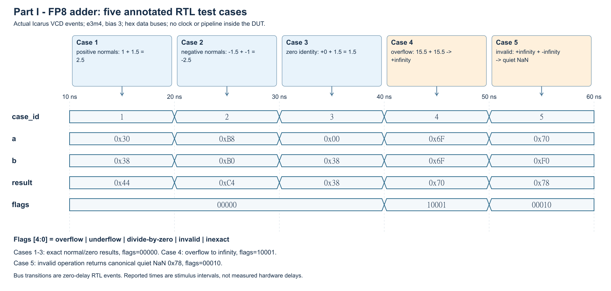
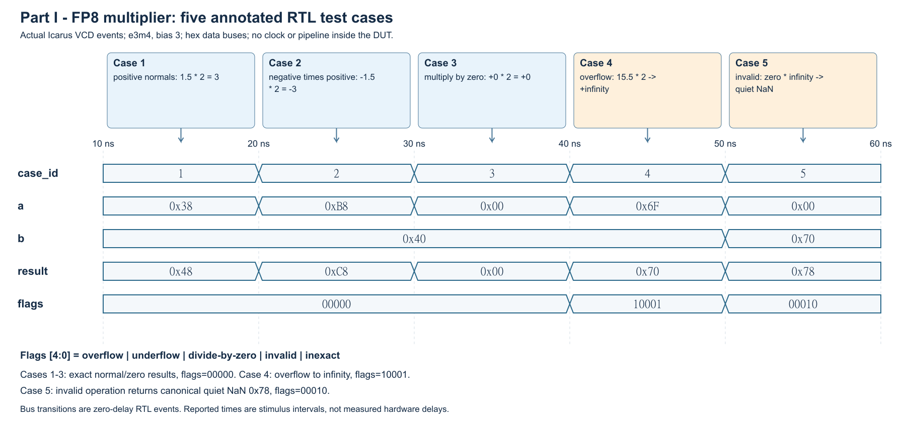

# Lab 3 - Part I: Floating-point arithmetic units

## 1. FP8 representation

The implemented e3m4 format uses one sign bit, three exponent bits and four
fraction bits, with exponent bias 3 and an implicit leading 1 for normals.

| Class | s / exponent / fraction | Representation / value |
|---|---|---|
| Zeros | s / 000 / 0000 | 0x00 (+0), 0x80 (-0) |
| Infinities | s / 111 / 0000 | 0x70 (+infinity), 0xf0 (-infinity) |
| NaNs | s / 111 / nonzero | 0x71..0x7f, 0xf1..0xff |
| Positive normals | 0 / 001..110 / any | 0x10..0x6f; +0.25 to +15.5 |
| Negative normals | 1 / 001..110 / any | 0x90..0xef; -15.5 to -0.25 |
| Positive denormals | 0 / 000 / nonzero | 0x01..0x0f; +0.015625 to +0.234375 |
| Negative denormals | 1 / 000 / nonzero | 0x81..0x8f; -0.234375 to -0.015625 |

Normal value = (-1)^s * (1 + fraction/16) * 2^(exponent-3).
Denormal value = (-1)^s * (fraction/16) * 2^(-2).
The ranges are discrete. Denormals are listed as required but arithmetic
support is omitted: denormal inputs are treated as signed zeros; an exact
nonzero result below 0.25 magnitude is flushed to signed zero before rounding
and raises underflow and inexact.

## 2. Adder and multiplier design

The handout-linked Fredrik Brosser FP32 adder and multiplier algorithms were
adapted to e3m4. All pipeline registers and clock/reset ports were removed.
Both units are fully combinational and return an eight-bit result.

The adder classifies operands, orders magnitudes, aligns the smaller
significand, adds or subtracts according to signs, normalizes, rounds, and
packs the result. Eight extension bits preserve the complete aligned value
over the supported exponent range. Exact cancellation produces +0.

The multiplier XORs the signs, adds exponents and removes bias 3, multiplies
the five-bit significands to a ten-bit internal product, normalizes, rounds,
and packs an eight-bit result. No external integer-product truncation is used.

Both use round-to-nearest, ties-to-even. A shared packer increments when the
first discarded bit is 1 and either a later discarded bit is 1 or the retained
LSB is odd. Rounding carry increments the exponent. Finite overflow returns
signed infinity. NaNs, signed zeros and infinities are explicitly classified;
invalid operations return canonical quiet NaN 0x78.

flags[4:0] = {overflow, underflow, divide_by_zero, invalid, inexact}.
Divide-by-zero is always 0. Quiet NaNs propagate; signaling NaNs raise invalid.
Infinity propagation alone raises no flag.

Reference links, archived source identities and necessary corrections to
upstream exception handling are documented in REFERENCE_ADAPTATION.md.

## 3. Simulation waveforms

These figures plot actual directed-test RTL simulation events. They each show
five self-checking cases: positive normals, negative result, zero, overflow
to infinity, and invalid arithmetic resulting in NaN.

Additional directed cases test underflow, exponent alignment, exact
cancellation, infinity propagation, signaling and quiet NaNs, and rounding
ties in both directions. See ADDER_CASES.md and MULTIPLIER_CASES.md.

Local Icarus SystemVerilog simulation passed 22 adder and 18 multiplier
directed cases. A separate exhaustive HDL test compared all 65,536 input
pairs per operation against an independent exact-rational model: 131,072
result-and-flag checks passed. This follows the explicit no-denormal policy
above. No synthesized frequency is inferred from the waveform times.

## 4. Source ZIP and final-report assembly

Run make package in part1_fp8 to create a ZIP with all RTL, testbenches,
Makefile, README, verification utilities and documentation. It excludes
generated simulation artifacts.

This is the Part I section, not the full final lab report. The group must add
its actual contribution summary, later parts and real demo confirmation to
the final report. Apporto VCS/Verdi rerun evidence can be added after running
the provided commands; the verification record does not claim those runs.
