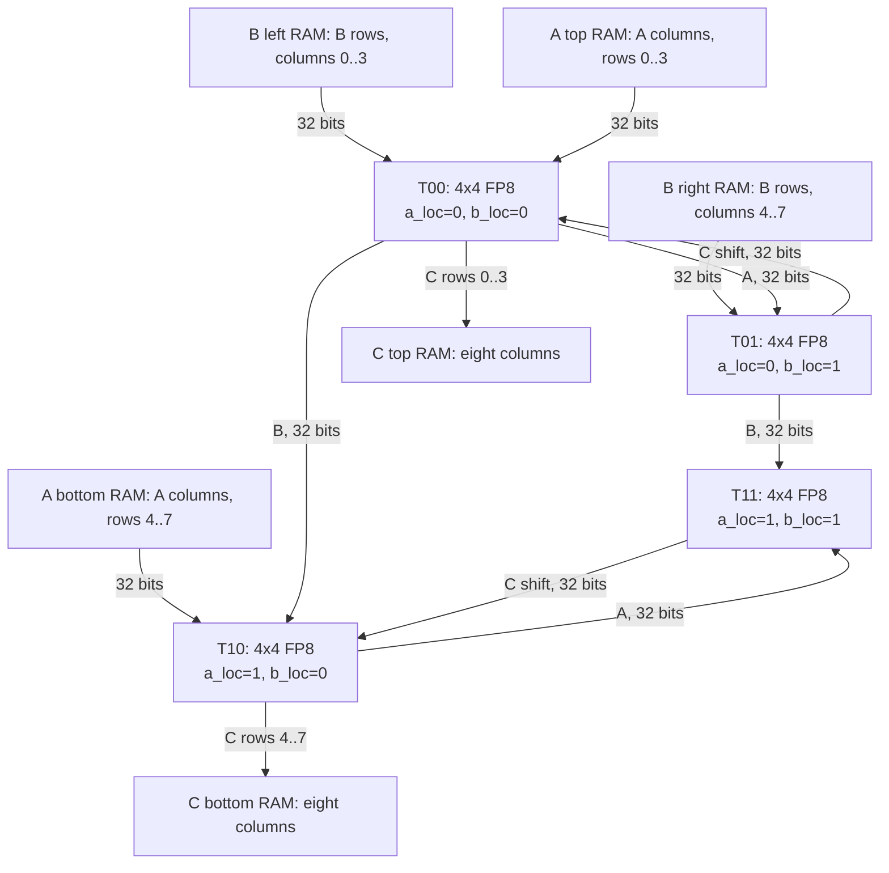

# 8x8 architecture

All tiles have `final_mat_mul_size=8`; every validity mask is `4'hf`.
`MAT_MUL_SIZE` remains 4. Every tile receives the same A/B/C bases and
strides. T00 owns A-top and B-left addresses; T01 owns B-right addresses;
T10 owns A-bottom addresses. Other tile input address outputs are unused.
All tile C address outputs are unused: the new core owns the output bank
address stream, derived from the actual write count, base and stride.

The controller's common clock, reset, PE reset and run reach every tile.
Each PE has an input register, separately rounded FP8 product register,
and separately rounded FP8 accumulator. The four sticky five-bit tile flag
vectors are bitwise ORed. No arithmetic partial sums cross tile boundaries:
each of the 64 PEs computes its full eight-term dot product. C links only
serialize the completed left/right columns into the two output banks.

## Packing

For k=0..7 and r=0..3, byte r is bits 8*r +: 8:

| Bank | Word k, lane r |
|---|---|
| A top | A[r][k] |
| A bottom | A[r+4][k] |
| B left | B[k][r] |
| B right | B[k][r+4] |
| C top | C[r][k] |
| C bottom | C[r+4][k] |

Host 64-bit loads concatenate bottom/top A and right/left B. Each bank is
still exactly 32 bits wide and retains the supplied RAM's one-clock,
read-first behavior. RAM content survives reset. Whole words are written;
external writes are disabled while busy. All host port inputs are driven.

## Completion and address correction

The unchanged Part II core asserts legacy done at count 17, independent of
final size. Its output latch correctly scales to count 26 for N=8. The new
controller keeps run high across that legacy pulse. The legacy done also
sets tile C address to base+stride before the later latch; that is why the
new core generates its own C address from written_columns instead.

At capture, the left and right tiles load their four completed columns.
The left outputs present columns 0..3, then columns 4..7 shifted from the
right tile. Only eight transfers reach each C RAM. The global completion
status follows the final committed RAM write, rather than the tile pulse.
