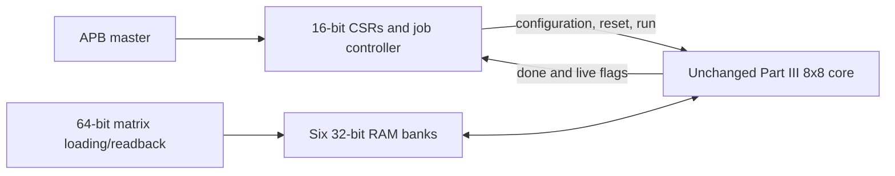

# Integration design

`matmul_apb_8x8.sv` reuses the six synchronous, read-first `part3_ram` banks
and `matmul_8x8`. The original Part III wrapper remains untouched. Its
previous-start edge detector and external host start/configuration ports
are replaced in the new top by `apb_matmul_control.sv`.

The controller owns both configuration and job state. IDLE accepts completed
APB writes. A write-one START transitions to PREPARE for one full clock,
asserting the core and PE resets; RUN then holds core_run high until the new
8x8 core's done. This clears accumulators and sticky arithmetic flags per job.
Legacy tile done signals are never used for software completion. The core's
capture at count 26 and eight writes at counts 27–34 remain unchanged.

PCLK is shared across all blocks. APB reset is active low; core reset is
active high and combines global reset with PREPARE. The one-cycle start
command is distinct from the sustained core_run level. Configuration writes
are blocked while busy, keeping addresses/strides stable without an extra
snapshot bank. Done and flags are retained in the controller after RUN ends.

APB controls the job and exposes status; it does not load matrix data. Existing
64-bit load/read ports retain the original packing: A and C by column, B by
row; low bank bytes correspond to indices 0–3 and high bank to 4–7. Host
writes are blocked while busy. C is read through its actual synchronous RAM
port in the testbench, not copied from expected values.

The supplied APB skeleton establishes the intended CSR approach but is
incomplete and has a five-bit data placeholder. This design uses the required
16 bits and a direct zero-wait ACCESS decode. A second bus phase FSM would
be redundant with PREADY permanently asserted. The task timing follows the
supplied `example_tb.v`, with read sampling moved to the completion edge,
bounded waits added, and all controls driven at falling edges.
